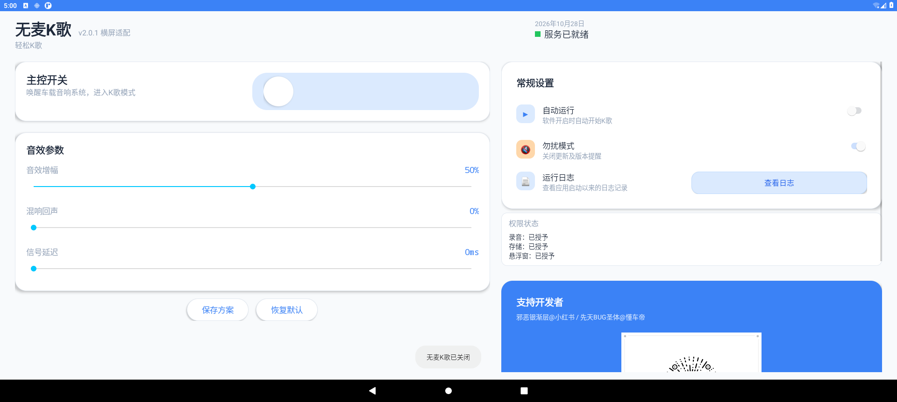
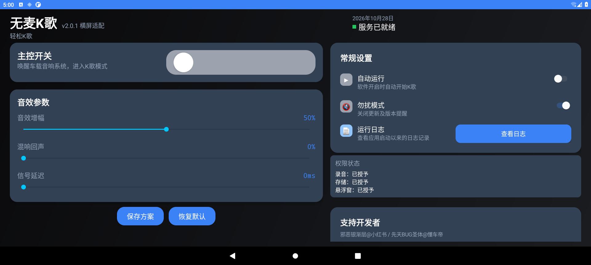

# 1920×862 横屏适配

此目录基于用户提供的 `无麦K歌_2.0.0.apk` 恢复 Java 源码及资源。
上游公开构建脚本仍保留在 `CarKaraoke/build_apk_final_audio.sh`；该脚本与此 APK 的音频实现及布局不同。
恢复时修正了反编译产生的异常声明、测试音采样率变量、AsyncTask 参数及安装方法的局部变量作用域。

原 APK SHA-256：`947d9bdd7b2ddd023b17ab0130ac8c92df12259f606a912ed21014ca6b6c8ed3`。
恢复工具：JADX 1.5.3。

## 界面变化

- 固定横屏；左右两栏分别显示开关/音效和设置/关于。
- 两栏独立滚动，缩短屏幕时仍可访问所有操作。
- 减少顶部空白和字体尺寸，适配 1920×862。
- 保留 2.0.0 的音频参数、路由、增益范围及原有处理链；此版本未加入新的 DSP 或 AEC。
- 补齐原 APK 遗漏的悬浮窗 Service 清单声明。
- 修复设置开关的保存回调被着色代码覆盖，以及已保存增益在启动时被重置的问题。

## 构建

需要 Python 3、JDK 17、Android SDK platform 34 与 build-tools 34.0.0。

```powershell
python android/build.py --sdk D:\SDKFiles --jdk C:\path\to\jdk17
```

输出：`android/build/CarKaraoke-2.0.1-wide.apk`。
使用本地生成的调试签名，不能直接覆盖原作者签名版本；安装前请先保存原应用配置。
不要运行上游旧脚本来构建此横屏版本。

## 验证

在 Android 11 模拟器上以 1920×862 测试：

- 160 dpi 浅色、200 dpi 深色模式，主控开关、三个滑块及保存/恢复按钮完整同屏显示。
- 滑动增益后数值更新，保存后日志显示对应增益，重启后增益保留。
- 勿扰模式切换后重启，开关保持选中。
- 运行日志对话框正常打开；测试期间未记录到 AndroidRuntime 崩溃。
- APK 签名验证通过。

未验证真实车机的麦克风、扬声器路由、延迟、声学反馈及音质。



